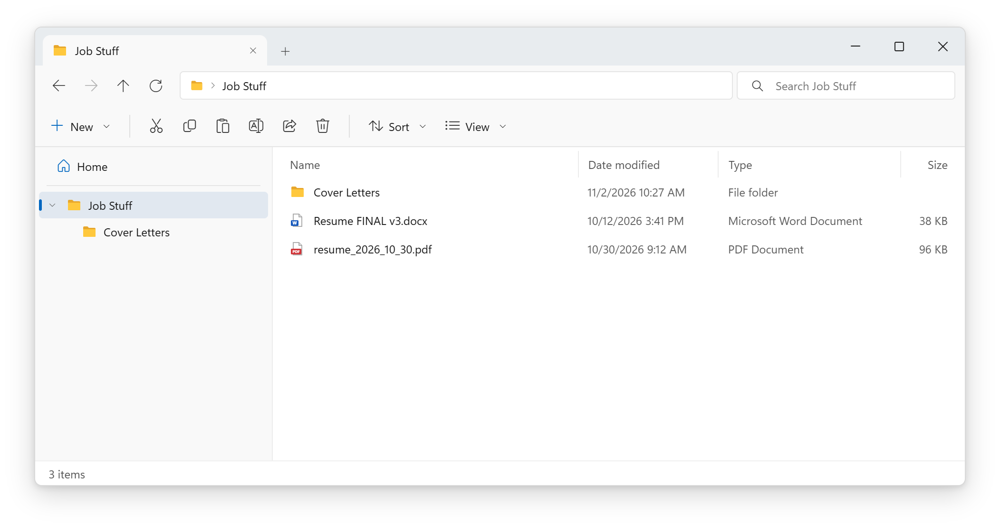
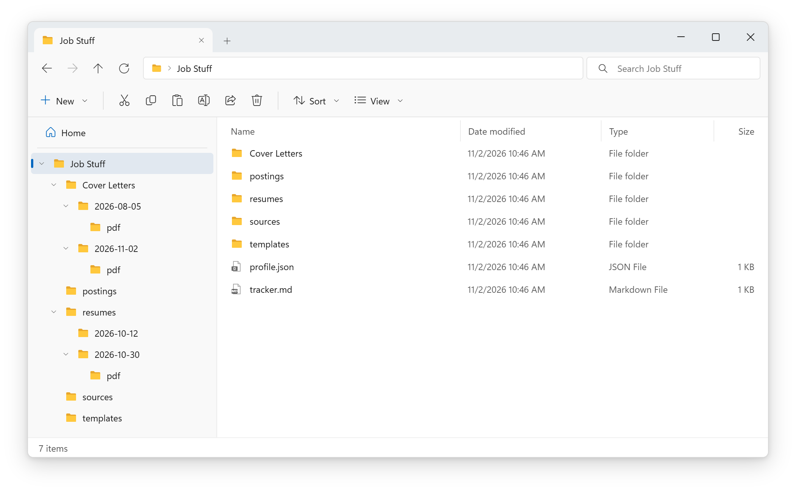

# job-hunt-kit

**Throw your career at it. Get an organized job search back.**

job-hunt-kit is a set of [Claude Code](https://claude.com/claude-code) skills for job hunting. Give it a resume in any format, a folder of old applications, your LinkedIn profile, or just tell it about yourself. It will:

- build a **living profile** of your experience, where every achievement keeps its proof,
- **sort every resume and cover letter into dated folders**, so the newest is always the current one,
- write **tailored resumes and one-page cover letters** using only facts you've confirmed,
- render **PDFs and check what an ATS will see**: a real text layer, your contact details on the page, the page limit, no broken characters or leftover placeholders,
- keep an **application tracker** that updates when you paste a rejection or interview email.

It works with the folders you already have and whatever date style you already use.

---

## Install

In Claude Code:

```
/plugin marketplace add NickSevostiyanov/job-hunt-kit
/plugin install job-hunt-kit@job-hunt-kit
```

Then open Claude Code in your job folder (an empty one is fine) and say:

```
set up my job folder
```

**Needs:** Claude Code, [Node.js](https://nodejs.org) 18+, and Chrome, Edge or Chromium for PDFs. There's nothing to `npm install`.

---

## What the first run looks like

**Before:** the usual mess. Files named three different ways, nothing dated, no idea which resume is current.



You say **"set up my job folder"**, and when it asks what you have, answer *"everything in here, plus my LinkedIn"*. Claude shows the plan before it moves anything:

```text
Resume FINAL v3.docx             ->  resumes/2026-10-12/              (date from the file)
resume_2026_10_30.pdf            ->  resumes/2026-10-30/pdf/
coverletter_acme_8-5-2026.pdf    ->  Cover Letters/2026-08-05/pdf/    (8-5 = Aug 5 or May 8? it asks)
Letter to Globex Nov 2 2026.pdf  ->  Cover Letters/2026-11-02/pdf/
```

**After:** every document is in a dated folder, with PDFs in their own `pdf/` folder and the profile and tracker at the top.



Your `Cover Letters` folder kept its name. If your folders had used `11-2-2026` style dates, new ones would too. Then it reads everything into `profile.json` and reports back:

```text
Added 3 roles, 2 projects, 1 credential, 14 skills (9 shipped, 3 familiar, 2 coursework).
LinkedIn: 2 things on your resume are missing from LinkedIn, worth adding there.
1 question: your resume says Acme "Jan 2025 - Present", LinkedIn says it ended Aug 2025. Which is right?
```

From then on, Claude starts every session in that folder knowing what's current:

```text
Profile updated 2026-11-02 (0 days ago).
Newest resume: resumes/2026-10-30/ (resume_2026_10_30.pdf)
Newest cover letter: Cover Letters/2026-11-02/ (Letter to Globex Nov 2 2026.pdf)
1 open question in profile.json waiting for the user.
New folders use YYYY-MM-DD, dated with today's date: 2026-11-02.
```

---

## Using it

Just talk to it. Each request below triggers one of the skills:

| You say | Skill | What happens |
|---|---|---|
| "set up my job folder" | `job-setup` | Creates the layout, adopts your existing folders, imports what you have |
| "here's my resume" / a file / a folder / a LinkedIn URL | `job-import` | Reads any format, files it by date, adds new facts to your profile |
| "I got AWS certified last week" / "that date is wrong" | `job-profile` | Updates the profile, logs the change, asks about conflicts |
| "tailor my resume to this posting" + the posting | `resume` | New dated version that leads with your real matches, ATS-safe, page-checked |
| "/cover-letter Acme Support Engineer" + the posting | `cover-letter` | One page, every claim traced to your profile, rendered and checked |
| paste a rejection email / "what's my status?" | `job-tracker` | Updates the right row, flags applications that need a follow-up |

## Your folder

```
my-job-search/
  profile.json            everything about you, with sources (the single source of truth)
  tracker.md              one row per application
  templates/              resume.html, coverletter.html (restyle freely)
  resumes/
    2026-10-30/           one folder per version, named by date
      resume_lee_2026-10-30.html
      pdf/resume_lee_2026-10-30.pdf
    2026-11-02/
      resume_lee_acme_2026-11-02.html
      pdf/resume_lee_acme_2026-11-02.pdf
  coverletters/
    2026-11-02/
      coverletter_acme_2026-11-02.html
      pdf/coverletter_acme_2026-11-02.pdf
  postings/               the job ads you applied to, saved
  sources/                original files: LinkedIn exports, old resumes
```

**Dated folders are never edited.** A change always becomes a new version in today's folder, so you always know exactly which file each employer received. "Newest" is worked out live from the folder names (it sorts real dates, so `10-27-2026` correctly comes after `9-20-2026`).

PDFs sit in their own `pdf/` folder, so an upload dialog shows only the files you'd send.

## The profile

`profile.json` holds everything the resumes and cover letters are built from. Each achievement carries its proof:

```json
{
  "text": "Wrote a PowerShell onboarding script that cut new-laptop setup from about two hours to 25 minutes.",
  "evidence": "Script in team repo; timing from the IT lead's onboarding checklist",
  "source": "linkedin-pdf",
  "as_of": "2026-10-30"
}
```

Beyond that, it holds:

| Field | What it's for |
|---|---|
| `skills` | `shipped`, `familiar` and `coursework`, kept separate so a resume never oversells |
| `do_not_claim` | Things you've decided not to list, and why |
| `rules` | Your hard lines: a title to never use, something not to disclose. Every skill obeys them |
| `open_questions` | Conflicts waiting for your answer. Nothing is silently overwritten |
| `no_ai_employers` | Companies that ban AI-written applications. For those you get fact bullets to write from yourself |
| `changelog` | Every change, in plain English |

A full example (fictional person) is in [`examples/profile.example.json`](examples/profile.example.json).

## LinkedIn

Paste your profile URL and it fetches whatever LinkedIn shows publicly, which is often just your name and headline. For the full picture, use one of these:

- **Save to PDF:** on your profile, click **More > Save to PDF**, then drop the file in.
- **Data export** (most complete): **Settings > Data privacy > Get a copy of your data**, then drop in the ZIP.

job-hunt-kit never logs in to LinkedIn or scrapes it. After an import it also tells you what's on your resume but missing from LinkedIn.

## Supported files

| Type | Read with |
|---|---|
| PDF, images, screenshots | Claude directly |
| .docx, .odt, .html, .md, .txt, .rtf | `extract.js` (built in, no dependencies) |
| .doc, .pages | Save as PDF or .docx first |

## FAQ

**Does my data leave my computer?**
Your files stay in your folder. Claude reads them in your session the same way it reads any file you work on. Nothing is uploaded anywhere else.

**I already have my own folder system.**
Keep it. Setup adopts folders named like `Resumes`, `RESUMES`, `CV` or `Cover Letters`, and the date style they already use. You can also set both in `profile.json` under `settings.folders` and `settings.date_format`.

**A4 paper?**
Say so during setup, or change `@page { size: Letter }` to `A4` in your two templates.

**Will it make things up?**
It's built not to. Every claim must come from `profile.json`, and every number needs evidence. Anything unclear becomes a question for you. Still read every document before you send it: your name is on it.

**Can I use it without the plugin system?**
Yes. Copy the folders in `skills/` into `~/.claude/skills/`. The session-start status line needs the plugin, but everything else works.

## Updating

```
/plugin marketplace update job-hunt-kit
```

The tools run from the plugin, not from copies in your folder, so updates apply everywhere at once. Your `profile.json`, documents and templates are never touched.

## Contributing

Issues and pull requests are welcome. Test changes on a throwaway job folder, never a real one. Run `claude plugin validate .` before opening a PR.

## License

[MIT](LICENSE)
